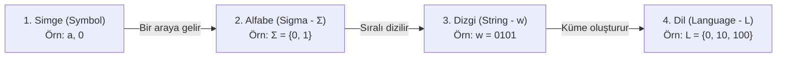
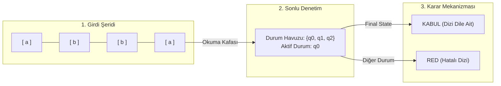

# 📚 Biçimsel Diller ve Otomata Teorisi
### Yazılım Mühendisliği Perspektifiyle Teori ve Uygulamalar

---

## 📑 İçindekiler
- [BÖLÜM 1: Sonlu Özdevinirler (Finite Automata - FA)](#bölüm-1-sonlu-özdevinirler-finite-automata---fa)
  - [1.1. Temel Kavramlar](#11-temel-kavramlar)
    - [Parça 1: Dört Temel Yapı Taşı](#parça-1-dört-temel-yapı-taşı)
    - [Parça 2: Sonlu Özdevinir (FA) Nedir, Şerit Modeli ve Karar Mekanizması](#parça-2-sonlu-özdevinir-fa-nedir-şerit-modeli-ve-karar-mekanizması)

---

# BÖLÜM 1: Sonlu Özdevinirler (Finite Automata - FA)

## 1.1. Temel Kavramlar

### Parça 1: Dört Temel Yapı Taşı

Biçimsel diller teorisinde tüm mimari 4 temel kavramın hiyerarşisi üzerine kuruludur:

#### 1. Simge (Symbol)
* **Tanım:** En küçük, bölünemez atomik karakterdir.
* **Örnek:** `a`, `b`, `0`, `1`
* **Yazılım Mühendisliği Karşılığı:** Kodundaki tek bir `char` veri tipidir.

#### 2. Alfabe — Sigma (Σ)
* **Tanım:** Boş olmayan, **sonlu** sayıdaki simgelerin oluşturduğu kümedir. Büyük Yunan harfi **Sigma (Σ)** ile gösterilir.
* **Örnekler:**
  * İkili (Binary) alfabe: **Σ = {0, 1}**
  * Harf alfabesi: **Σ = {a, b}**
  * İngiliz alfabesi: **Σ = {a, b, c, ..., z}**
* **Yazılım Mühendisliği Karşılığı:** Programında izin verdiğin geçerli karakter setidir (ASCII veya UTF-8 alt kümesi).

#### 3. Dizgi / Kelime / Sözcük (String — w)
* **Tanım:** Alfabedeki simgelerin sonlu sırada yan yana gelmesiyle oluşan karakter dizisidir.
* **Örnek:** Alfabe Σ = {a, b} ise:
  * `w = aba`
  * `w = bbabb`
* **Dizgi Uzunluğu (|w|):** Dizgideki toplam simge sayısıdır.
  * Örneğin `w = abba` ise uzunluğu **|w| = 4** olur.
* **Özel Durum: Boş Dizgi — Lambda (λ) veya Epsilon (ε):**
  * İçinde hiç simge bulunmayan boş dizgidir.
  * Uzunluğu her zaman sıfırdır: **|λ| = 0**
  * **Yazılım Karşılığı:** Boş metin `""` (empty string).

#### 4. Dil (Language — L)
* **Tanım:** Bir alfabeden üretilebilecek anlamlı dizgilerin oluşturduğu kümedir (yani alfabenin oluşturabileceği tüm dizgiler evreni olan Σ* kümesinin bir alt kümesidir: L ⊆ Σ*).
* **Örnek:** Alfabe Σ = {0, 1} olsun.
  * Çift sayılar dili: **L = {0, 10, 100, 110, ...}** (sonu 0 ile biten tüm ikili dizgiler).
* **Yazılım Mühendisliği Karşılığı:** Geçerli bir sözdizimi kuralıdır (Syntax Validation).
  * Örneğin: *"Geçerli e-posta adresleri kümesi"* veya *"Python'daki geçerli değişken adları"*.

#### 📝 Not Defterine Yazılacaklar (Hap Bilgiler)
1. **Simge (Symbol):** Bölünemez en küçük karakter (`0`, `1`, `a`).
2. **Alfabe (Σ):** Boş olmayan, sonlu simgeler kümesi (Örn: `Σ = {0, 1}`).
3. **Dizgi (w):** Alfabedeki simgelerin dizilimi. Uzunluğu `|w|` ile ifade edilir.
4. **Boş Dizgi (λ veya ε):** Karakter içermeyen dizgidir. `|λ| = 0`.
5. **Dil (L):** Alfabeden türetilen geçerli dizgiler kümesidir (`L ⊆ Σ*`).

---

### Parça 2: Sonlu Özdevinir (FA) Nedir, Şerit Modeli ve Karar Mekanizması

#### 1. Soyut Şerit Modeli (Tape Model)
Bir Sonlu Özdevinir (FA) teorik olarak soldan sağa çalışan şu 3 ana parçadan oluşur:

#### 2. Bileşenlerin Görevleri ve Yazılım Mühendisliği Karşılığı

* **1. Girdi Şeridi (Input Tape):**
  * **Tanım:** Üzerinde okunacak dizginin simgeleri (`a`, `b`, `b`, `a`) sırayla yazılı olan şerittir.
  * **Kural:** Okuma kafası her adımda **yalnızca bir simge** okur ve **sadece soldan sağa doğru** ilerler (standart modelde asla geri gidemez).
  * **Yazılım Karşılığı:** Kodundaki bir `string` üzerinde karakter karakter ilerleyen `index` işaretçisi (pointer).

* **2. Sonlu Denetim Birimi (Finite Control - FSM):**
  * **Tanım:** Makinenin beynidir. Makine tek bir başlangıç durumundan (`q₀`) başlar.
  * **Kritik Özellik (Belleksizlik):** Bu makinenin harici bir RAM'i, dizisi ya da yığıtı (stack'i) **YOKTUR**. Tek hatırlayabildiği şey: *"Şu anda hangi durumdayım (state)?"* sorusunun cevabıdır.
  * **Yazılım Karşılığı:** Bir `switch-case` veya `enum State { IDLE, READING, DONE }` yapısıdır.

* **3. Karar Mekanizması: Kabul (Accept) ve Red (Reject):**
  Bir dizgi şeritte baştan sona okundu ve bitti. Makine bu dizgiyi kabul mü edecek, red mi?
  * **Kabul (Accept):** Dizginin son simgesi okunduktan sonra makinenin ulaştığı durum bir **"Kabul Durumu" (Accepting / Final State)** ise dizgi geçerlidir (KABUL).
  * **Red (Reject):** Dizgi bittiğinde makine kabul durumunda değilse, dizgi dile ait değildir (RED).
  * **Yazılım Karşılığı:** Bir `regex.test(input)` fonksiyonunun `true` ya da `false` dönmesi veya derleyicinin sözdizimi hatası (Syntax Error) vermesi.

#### 📝 Not Defterine Yazılacaklar (Hap Bilgiler)
1. **Sonlu Özdevinir (FA):** Belleği yalnızca sonlu durumlarla sınırlı olan, harici belleksiz (RAM'siz) soyut tanıma makinesidir.
2. **Şerit Modeli 3 Parçadan Oluşur:**
   * **Girdi Şeridi:** Simgeleri tutar, sadece soldan sağa tek yönlü okunur.
   * **Okuma Kafası:** Her adımda bir simge ilerler.
   * **Sonlu Denetim Birimi:** O anki duruma ve gelen simgeye göre yeni duruma geçer.
3. **Kabul / Red Kuralı:** Dizgi tamamen bittiğinde makinenin durduğu durum bir **Kabul Durumu (Final State)** ise KABUL edilir; aksi halde RED edilir.

---
